# AI Regression Gate

Deterministic, auditable release checks for AI-assisted development. The `argate` CLI maps a Git diff to components, selects the relevant tests, executes them, and applies explicit release policy. Optional model advice provides context while executed checks determine the gate result.

## From a diff to a release decision

```mermaid
flowchart LR
G["Git base and head<br/>validated commit SHAs"]:::source --> D["Diff and component mapping"]:::process
    D --> T["Deterministic test selection"]:::process
    T --> E["Execute configured groups<br/>timeouts and fresh coverage"]:::process
    E --> P{"Release policy"}:::review
    P --> R["READY · WARNING · BLOCKED"]:::result
    R --> O["JSON and Markdown evidence<br/>SHAs · reasons · test results"]:::store
    D -.-> A["Optional sanitized<br/>model advisory"]:::review
    A -.-> T
    classDef source fill:#e0f2fe,stroke:#0284c7,color:#0c4a6e
    classDef process fill:#ede9fe,stroke:#7c3aed,color:#3b0764
    classDef store fill:#dcfce7,stroke:#16a34a,color:#14532d
    classDef review fill:#fef3c7,stroke:#d97706,color:#78350f
    classDef result fill:#f1f5f9,stroke:#475569,color:#0f172a
```



## Try the regression-and-fix demo

Requires Python 3.12+ and Git. The deterministic demo requires no model, API key, or cloud account.

```bash
git clone https://github.com/C0deRhin0/ai-regression-gate.git
cd ai-regression-gate
python3 -m venv .venv
. .venv/bin/activate
python -m pip install -e '.[dev,demo]'
python scripts/demo.py
```

The demo creates temporary Git repositories around a small appointment API. Removing duplicate-booking validation selects the scheduling regression tests and produces **BLOCKED** with exit code `1`. Restoring the guard produces **READY FOR STAGING** with exit code `0`. The temporary repositories are removed; reports remain in `reports/demo/blocked/` and `reports/demo/ready/`.

See [the demo walkthrough](docs/demo.md) for the assertions and code-tour entry point.

## Use it in another repository

Install the package into that project's environment, adapt [.argate.example.yml](.argate.example.yml), and run from a committed checkout:

```bash
argate config validate --config .argate.yml
argate analyze --base origin/main --head HEAD --no-ai
argate evaluate --base origin/main --head HEAD --no-ai --report-dir reports/release
```

`evaluate` executes configured commands and requires a clean tracked tree at the selected head SHA. Those commands are trusted repository code, not sandboxed input. Read the configuration and security model before evaluating untrusted contributions.

| Command | Result |
| --- | --- |
| `config validate` | Validate mappings, groups, coverage settings, and policy |
| `analyze` | Inspect impact and selected checks without certifying readiness |
| `test` | Run selected groups and return required-test status |
| `evaluate` | Execute checks, enforce full policy, and write audit reports |

## What the gate records

- Base/head identity, changed paths, component mappings, selection reasons, and risk findings.
- Commands, bounded sanitized output, timeouts, required/optional results, and fresh coverage when configured.
- Policy outcome and reasons in versioned JSON and readable Markdown.
- Optional deterministic, Ollama, or OpenAI-compatible advisory results; external transmission is an explicit configuration choice.

Required test failures always block. `analyze` and `test` are narrower operations and cannot claim release readiness. See [configuration](docs/configuration.md) for exit codes and policy defaults.

## Development and CI

```bash
ruff check .
python -m pytest --cov=argate --cov-report=xml --cov-fail-under=80 -q
python scripts/demo.py
```

The example [GitHub Actions workflow](.github/workflows/regression-gate.yml) evaluates the PR head and retains reports as artifacts. Branch protection is configured separately from the workflow.

| Read next | Purpose |
| --- | --- |
| [Architecture](docs/architecture.md) | Collection, analysis, selection, execution, and policy boundaries |
| [Configuration](docs/configuration.md) | Field reference, globs, coverage, and model settings |
| [GitHub Actions](docs/github-actions.md) | CI integration and required checks |
| [Security](docs/security.md) | Trusted commands, source redaction, and provider boundaries |
| [Implementation status](docs/implementation-status.md) | Recorded verification and remaining limits |

## License

[MIT](LICENSE).
